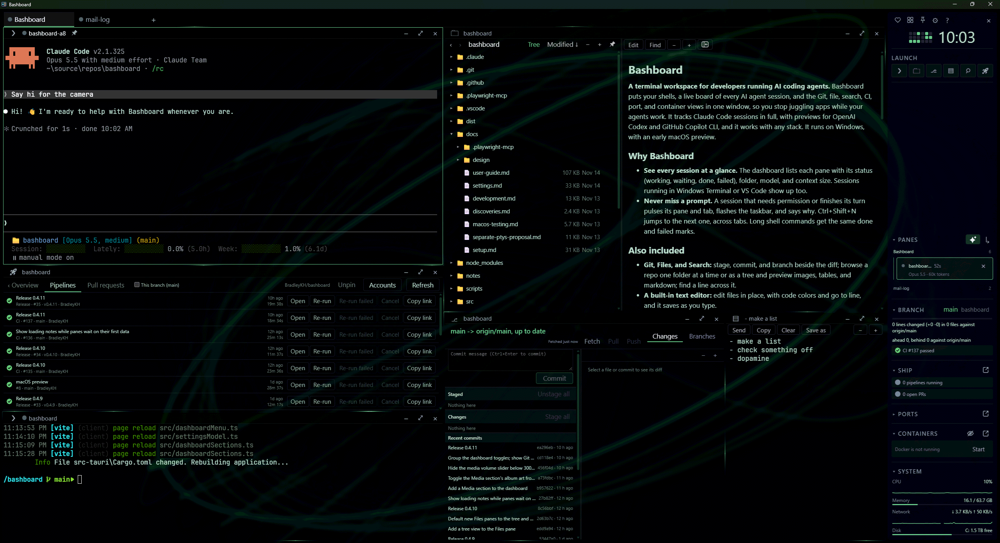

Bashboard
=========

**A terminal workspace for developers running AI coding agents.** Bashboard puts your shells, a
live board of every AI agent session, and the Git, file, search, CI, port, and container views in one window, so you stop juggling apps while your
agents work. It tracks Claude Code sessions in full, with previews for OpenAI Codex and GitHub
Copilot CLI, and it works with any stack. It runs on Windows and, as an early build, on Debian
and Ubuntu Linux, with macOS and other Linux packages available for testing.



## Why Bashboard

- **See every session at a glance.** The dashboard lists each pane with its status (working,
  waiting, done, failed), folder, model, and context size. Sessions running in Windows Terminal
  or VS Code show up too, and a Needs you list gathers what waits on you, from prompts to pull
  requests to agent usage limits.
- **Never miss a prompt.** A session that needs permission or finishes its turn pulses its pane
  and tab, flashes the taskbar, and says why. Ctrl+Shift+N jumps to the next one, across tabs.
  Long shell commands get the same done and failed marks.

## Also included

- **Git, Files, and Search:** stage, commit, and branch beside the diff; browse a repo one folder at
  a time or as a tree and preview images, tables, and markdown; find a line across it.
- **A built-in text editor:** edit files in place, with code colors and go to line, and it
  saves as you type.
- **Pins:** keep the files, folders, and commands you use most one click away, per repo or
  everywhere.
- **Ship:** CI runs, job logs that open at the first error, and pull requests from GitHub,
  GitLab, Bitbucket, and Azure DevOps, ranked by what needs you, with a Fix with agent action
  that hands a failed run to your coding agent.
- **Ports and Local Browser:** see and stop dev servers, preview `localhost` beside the
  terminal, and open local HTML files (such as a generated report) in the same pane.
- **Containers:** start, stop, tail, and shell into Docker or Podman containers.
- **Tabs, layouts, and the command palette:** workspaces restore on relaunch, named layouts
  rebuild one in a click, and Ctrl+Shift+P reaches everything.
- **Branch size meter:** a badge on the Git pane and session cards warns when an agent's branch
  sprawls past a line limit, an optional dashboard section tracks it, and `bb pr size` lets the
  agent check before it commits.
- **The `bb` CLI and scratch pads:** open panes from any prompt, wait for CI and read why it
  failed (`bb ci`), and draft longer prompts before sending them.
- **Dashboard extras:** a clock, system load and disks, and controls for the media playing.
- **Backdrops and effects:** a live colony simulation, Galaxy, Matrix, a load-driven wave, or
  your own image, dimmed to taste, plus an optional glow on working agents and lights around
  pane borders.
- **Codex, Copilot, and local AI models:** the same status and notifications for other agents,
  plus what Ollama and LM Studio have loaded.

The [user guide](docs/user-guide.md) covers each in detail.

## Installing

### Windows

Download `Bashboard_<version>_x64-setup.exe` from the
[latest release](https://github.com/BradleyKH/bashboard/releases/latest) and run it. It installs
for the current user without admin rights and includes everything Bashboard needs: the app, the
`bb` pane CLI, and the terminal font. Bashboard checks for new releases at launch and updates
itself from inside the app. It also adds **Open in Bashboard** to File Explorer's right-click
menu.

The installer is not code-signed, so Windows SmartScreen shows "Windows protected your PC" the
first time. Click **More info**, then **Run anyway**.

Bashboard runs the tools you already use:

1. **Git for Windows**, which provides Git Bash, the default shell. If it's missing, the setup
   wizard offers to install it with winget (no admin rights needed), or install it yourself:

   ```sh
   winget install --id Git.Git -e
   ```

   Without Git, panes open in PowerShell or Command Prompt instead.

2. **Claude Code**, for session status, attention, and the dashboard. Run `claude` once before
   starting Bashboard so the setup wizard offers to install its hooks
   (see [Claude Code hooks](docs/setup.md#claude-code-hooks)). Codex and Copilot CLI work the
   same way, as a preview (see [Agent hooks](docs/setup.md#agent-hooks)).

3. **Optional:** Docker Desktop or Podman for the containers list.

On first launch, a setup wizard walks you through the shell, the lines that let new panes open in
the current folder, your editor, favorite repos, coding agent hooks, and the look. Each choice
saves as you make it, and **Run setup** in the Help tab (F1) brings the wizard back. A short,
skippable tour of the main keys follows; **Take the tour** in the Help tab replays it.

WebView2 comes with Windows 11; on a machine without it, the installer downloads it. Uninstall
from **Settings > Apps > Installed apps**.

### Linux

Linux support is early. The `.deb` is tested on Kubuntu with KDE Plasma, under X11 and Wayland;
GNOME is partly tested (on CachyOS), other desktops are not yet, and the Local Browser pane is
Windows only. Download
`bashboard_<version>_amd64.deb` from the
[latest release](https://github.com/BradleyKH/bashboard/releases/latest) and install it on
Ubuntu 22.04 or newer, Debian 12 or newer, or a distro based on them:

```sh
sudo apt install ./bashboard_*_amd64.deb
```

It pulls in WebKitGTK and GTK, puts `bashboard` on your `PATH`, and adds **Open in Bashboard** to
Dolphin's and Nemo's right-click menus. Bashboard checks for new releases at launch and updates
the package itself, asking for your password to install it. Panes open in your login shell (bash,
zsh, or fish), and the setup wizard offers the same shell lines and agent hooks as on Windows.
Uninstall with `sudo apt remove bashboard`.

On Arch, CachyOS, Manjaro, or EndeavourOS, download `bashboard-<version>-1-x86_64.pkg.tar.zst`
from the same release and install it with pacman:

```sh
sudo pacman -U bashboard-*-x86_64.pkg.tar.zst
```

It has the same layout and file manager actions as the `.deb`, but does not update itself: install
the next release's package the same way. Uninstall with `sudo pacman -R bashboard`.

On Fedora, download `bashboard-<version>-1.x86_64.rpm` and install it with
`sudo dnf install ./bashboard-*.x86_64.rpm` (on RHEL 10, `sudo dnf install epel-release` first).
On any other distro, download `bashboard_<version>_amd64.AppImage`, make it executable with
`chmod +x`, and run it; on first launch it offers to add itself to your applications menu.
Neither updates itself: install or download the next release's file the same way.

### macOS

macOS builds are an early preview for testing; see
[Testing a macOS preview build](docs/macos-testing.md).

To build from source on any of them, see [Development](docs/development.md).

## Documentation

- [User guide](docs/user-guide.md): tabs, panes, layouts, the dashboard, Files and the text
  editor, pins, Git, code search, containers, ports, Local Browser, the Ship pane, local AI models, attention, and the
  `bb` pane CLI.
- [Shell and coding agent setup](docs/setup.md): the `~/.bashrc` lines that let new panes open
  in the current folder, the hooks for Claude Code, Codex, and Copilot, and signing
  in to GitHub, GitLab, Bitbucket, and Azure DevOps for the Ship pane.
- [Settings](docs/settings.md): the settings file and what each setting does.
- [Development](docs/development.md): building from source, releasing, and debugging input.
- [Testing a macOS preview build](docs/macos-testing.md): installing an early macOS build and
  what to check.
- [Testing a Linux build](docs/linux-testing.md): installing a Linux package (from a release,
  or an unreleased build from CI) and what to check on a real machine.
- [Design](docs/design/README.md): the spec, for anyone changing Bashboard itself.

## License

MIT, see [LICENSE](LICENSE).
